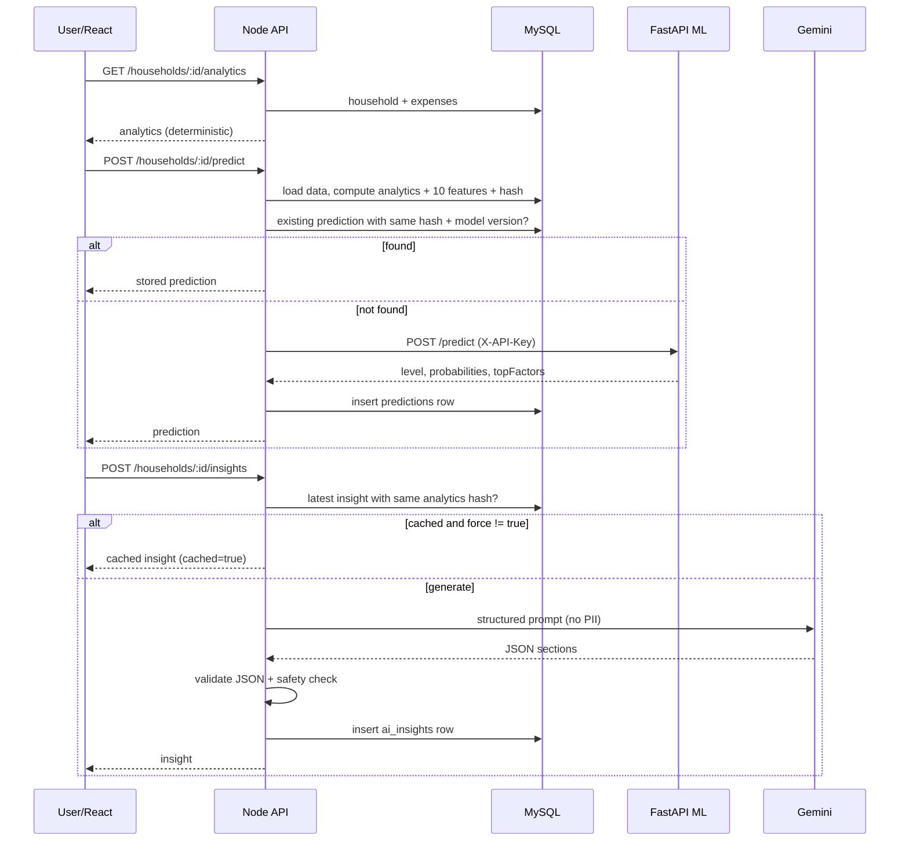

# 05 — User Flow and System Workflow

## 1. Main user flow
```
LANDING → REGISTER / LOGIN → DASHBOARD
   → CREATE HOUSEHOLD (step 1: members & income, step 2: expense items)
   → ANALYTICS → PREDICTION → AI INSIGHTS
   → (optional) SAVE MONTHLY RECORD → (optional) REPORT
```
Only the first three arrows after the dashboard are required to get value. Monthly records and reports are never prompted as mandatory.

## 2. Create-household workflow
1. User opens `/households/new`.
2. Step 1 form: name, location, members, earning, dependent, children, elderly, monthly income. Client validation runs per field.
3. Step 2 form: add expense items (category, amount, essential toggle, description). Running total is shown **for convenience only**.
4. Submit → `POST /api/households` with `expenses[]`.
5. Backend validates (zod), inserts household + expenses in one transaction, returns the household.
6. Frontend sets it as active household and routes to `/households/:id/analytics`.

## 3. Edit workflow (no monthly record needed)
Edit household or expense → `PUT`/`POST`/`DELETE` → backend updates the **current** tables only → frontend refetches analytics → predictions and insights now show a **"Out of date — regenerate"** badge because their `isStale` flag is true. Saved monthly records are untouched.

## 4. Analytics → prediction → insights sequence


## 5. Optional monthly record workflow
`Save as Monthly Record` → modal (month, year defaults to current, notes) → `POST /monthly-records` → backend recomputes analytics, links the latest matching prediction/insight if hashes match (else tries prediction once, else null) → inserts snapshot → history page shows it. If month exists → `409 CONFLICT`; UI asks to overwrite → resend with `overwrite: true`.

## 6. Optional report workflow
Reports page → choose Current or Monthly (pick saved record) → `POST /households/:id/reports` → backend assembles `reportData`, stores row with snapshot → preview at `/reports/:reportId` → **Download PDF** → `GET /api/reports/:reportId/download`.

## 7. Failure flows
| Failure | System behavior | User sees |
|---|---|---|
| ML down/timeout | `503 ML_UNAVAILABLE`; analytics, expenses, history still work | "Prediction is temporarily unavailable. Your household analytics are still available." |
| Gemini down/timeout/invalid output | `503 AI_UNAVAILABLE`; previous insights (if any) remain viewable | "AI suggestions are temporarily unavailable. Your household analytics are still available." |
| Token expired | `401 TOKEN_EXPIRED` | Redirect to login with notice, return-to path preserved |
| Validation error | `422 VALIDATION_ERROR` with field details | Inline field errors |
| PDF failure | `500 REPORT_GENERATION_FAILED` | Alert with retry; preview still visible |
| Insufficient data | `422 INSUFFICIENT_DATA` | Prompt to add expenses |

## 8. Navigation map
Sidebar: Dashboard · Household · Expenses · Analytics · Prediction · AI Insights · History · Reports · Settings. Household-scoped links use the active household id.
