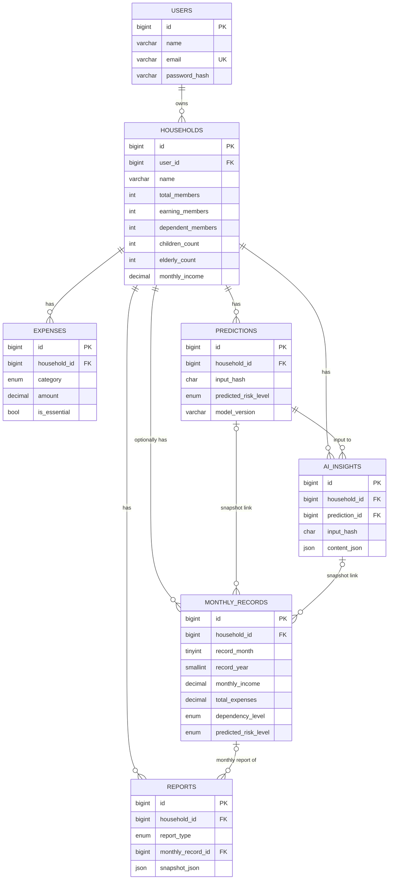

# 08 — ER Diagram Specification

## 1. Textual description
A **user** owns many **households**. Each household has many **expenses** (current items), many **monthly_records** (optional history, at most one per month), many **predictions**, many **ai_insights**, and many **reports**. A monthly record may point to the prediction and insight that were current when it was saved. A MONTHLY report may point to its monthly record.

## 2. Mermaid ER diagram

## 3. Relationships
| Parent | Child | Cardinality | FK | On delete |
|---|---|---|---|---|
| users | households | 1 : 0..10 (app limit) | households.user_id | CASCADE |
| households | expenses | 1 : 0..n | expenses.household_id | CASCADE |
| households | monthly_records | 1 : 0..n (unique per month) | monthly_records.household_id | CASCADE |
| households | predictions | 1 : 0..n | predictions.household_id | CASCADE |
| households | ai_insights | 1 : 0..n | ai_insights.household_id | CASCADE |
| households | reports | 1 : 0..n | reports.household_id | CASCADE |
| predictions | ai_insights | 1 : 0..n | ai_insights.prediction_id | SET NULL |
| predictions | monthly_records | 1 : 0..n | monthly_records.prediction_id | SET NULL |
| ai_insights | monthly_records | 1 : 0..n | monthly_records.insight_id | SET NULL |
| monthly_records | reports | 1 : 0..n | reports.monthly_record_id | SET NULL |

## 4. Normalization notes
- 3NF for current data: demographics are attributes of the household (one-to-one), so a separate table adds no value.
- Controlled denormalization is limited to `monthly_records` snapshots and JSON payloads (`features_json`, `content_json`, `snapshot_json`), each justified in `07`.

## 5. Integrity rules enforced in DB
CHECK constraints for counts and amounts; unique email; unique month per household; foreign keys with explicit cascade; enums for categories and levels.
